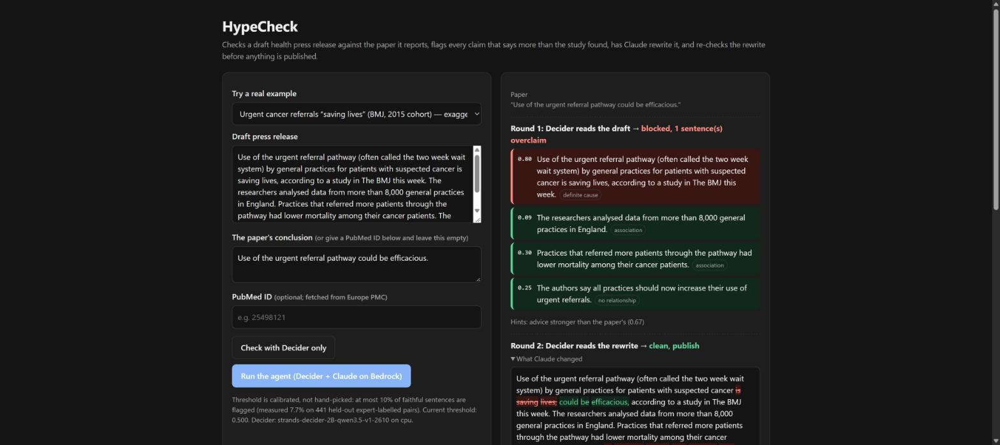
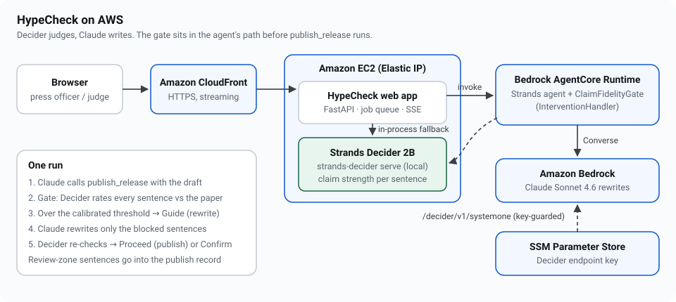

# HypeCheck

**HypeCheck reads a draft health press release next to the paper it reports, flags every sentence
that claims more than the study found, has Claude rewrite it, and re-checks the rewrite before
anything is published.**

**Every 1,000 honest press-release sentences: Claude Sonnet as the judge wrongly blocks 296 and costs $0.97. HypeCheck wrongly blocks 67 and costs $0.18 ($0 on your own GPU).**

On 345 press releases that experts judged faithful to their paper, HypeCheck wrongly flagged
**6.7%**. Claude asked the same question flagged 29.6% (Sonnet 4.6) to 44.9% (Haiku 4.5). The gap
holds against all three Claude models in a paired bootstrap (Sonnet: 22.9 points fewer false flags,
95% CI 17.8–27.9). On the full 563-pair benchmark it scores macro-F1 **0.498 zero-shot**
(95% CI 0.452–0.541), level with the best published system (0.4735), which was trained on the task.

| | |
|---|---|
| **Live demo** | https://d174bz5yly61n4.cloudfront.net (click *New here? 30-second tour*) |
| **HypeWatch** | https://d174bz5yly61n4.cloudfront.net/hypewatch: 85 real NIH releases checked against their papers, updated daily |
| **Developers** | https://d174bz5yly61n4.cloudfront.net/developers: free API key in one click, REST API, MCP connector, bring your own data or AWS |
| **Decision pattern** | [`decision_pattern/`](decision_pattern/README.md): a claim-fidelity gate, `#guardrails` |
| **Article** | [ARTICLE.md](ARTICLE.md) |
| **Video** | *(YouTube link)* — generated reproducibly by [`video/make_video.py`](video/make_video.py) |
| **Tags** | `#strands-decider-2b` `#guardrails` |



## The decision handed to Strands Decider

Decider gets one typed question, asked of the paper's conclusion and then of every sentence in the draft:

> *How strong is the relationship this statement claims?*
> `no_relationship` < `correlational` < `conditional_causal` < `direct_causal`

The overclaim score is `P(sentence level > paper level)`. A Strands `InterventionHandler` runs it
in `before_tool_call` on `publish_release`. Each sentence then lands in one of three zones, and
both thresholds are conformal, fitted on held-out expert-labelled data:

| Zone | Rule | What happens |
|---|---|---|
| **BLOCK** | score > 0.50 (α = 0.10) | `Guide`: Claude rewrites those sentences, then the rewrite is re-checked |
| **REVIEW** | 0.40 < score ≤ 0.50 (α = 0.20) | Low confidence. Doesn't block; listed for an editor in the publish record |
| **OK** | score ≤ 0.40 | Passes |
| | still blocked after 3 rewrites | `Confirm`: a person decides |

Decider only classifies; plain code decides; Claude cannot argue with a number. In one recorded
AgentCore run, Claude's first rewrite *still* overclaimed (0.56). The gate caught it and the
third round was clean.

## Why this problem

- **The exaggeration starts upstream.** Most exaggeration in health news starts in the press
  release, not the newsroom (Sumner et al., *BMJ* 2014, 462 releases). A third of releases turned
  correlation into causation. When the release exaggerated, 81% of the news did too.
- **Fixing the release works.** A randomised trial in 9 press offices showed that aligning releases
  with the evidence made headlines more accurate with no loss of coverage (Adams et al.,
  *BMC Medicine* 2019).
- **Nobody has automated it.** The only free human pre-publication review service closed in 2018,
  and no tool checks a draft against its own paper.

## Results

All test data is published expert coding that we did not write. Every experiment was
pre-registered before it ran ([research/](research/README.md)), seven in all, and every
missed prediction is reported.

| Measurement | Decider 2B (zero-shot) | Claude on Bedrock, same question |
|---|---|---|
| Faithful releases wrongly flagged (the negative control) | **6.7%** (CI 4.1–9.4%) | Haiku 4.5 44.9% · Sonnet 4.6 29.6% · Opus 4.6 40.0% |
| Exaggeration macro-F1, 563 pairs (Wright & Augenstein 2021) | **0.498** (CI 0.452–0.541; published best 0.4735, trained: a statistical tie) | Haiku 0.358 · Sonnet 0.401 · Opus 0.460 |
| Exaggerates-vs-not AUROC | **0.716** | Haiku 0.570 · Sonnet 0.580 · Opus 0.663 |
| Conformal promise (≤10% false flags) vs measured, 441 unseen non-overclaim pairs | 7.7% (95% CI 5.6–10.6%) | — |
| Recall at that strict threshold | 39% (CI 30–47%) | Haiku at ~10% false flags: 18% |
| Advice inflation, 116 real UK releases (InSciOut), AUROC | 0.84 | — |
| Causal strength, 3,061 PubMed sentences (Yu 2019), direct-vs-correlational AUROC | 0.894 | — |
| Latency per decision | 160 ms (laptop RTX 4070) · ~0.9 s (EC2 CPU) | Haiku ~2.0 s · Sonnet ~0.9 s · Opus ~5.3 s |
| Cost per sentence checked | $0.00018 (c7i CPU at full use) · $0 on owned hardware | Haiku $0.00051 · Sonnet $0.00097 · Opus $0.0056 |

Cost basis:
- **Claude:** tokens actually used across 563 checks × Bedrock list price (Haiku 4.5 $1/$5, Sonnet 4.6 $3/$15, Opus 4.6 $5/$25 per million tokens in/out).
- **Decider:** c7i.4xlarge on-demand at $0.714/h × 0.9 s per decision.

**Measured limits:**
- 39% recall at the strict threshold: it is a safety net, not a full reviewer.
- The animal-to-human hint is weak: AUROC 0.61 on 45 releases, so it never blocks.
- 563 pairs give wide intervals.
- The demo server runs Decider on CPU, because a GPU quota request was still pending.

## HypeWatch: the same check on real releases

Benchmarks are curated, so we also pointed HypeCheck at text nobody chose for us: every NIH news
release from February 2023 to October 2026 that cites its paper by DOI. These releases are
public domain. That is 85 releases and 615 sentences. Each headline, subtitle and opening
sentence was checked against the paper's abstract, and Claude suggested a rewrite for every
blocked sentence.

| Pre-registered measure | Result |
|---|---|
| Releases with a sentence the gate would block, strict public rule | **15.3%** (13 of 85; predicted 3–20%) |
| Same under the benchmark rule (conclusion only) | 43.5% (predicted 20–50%) |
| Headlines vs body, mean overclaim score | 0.20 vs 0.19, no meaningful gap |
| Claude's suggested rewrites that pass Decider's check | 66.7% (**missed** the 85% prediction, so they are shown as suggestions) |

The public rule only flags a sentence that claims more than the conclusion *and* more than the
strongest claim anywhere in the abstract. That avoids flagging an animal result reported earlier
in the abstract, and since it can only remove flags, the calibrated false-flag bound still holds.
A systemd timer on EC2 checks new releases every morning (`hypecheck/hypewatch.py`).

## AI summaries: a second use case

Peters & Chin-Yee (2025, *R. Soc. Open Sci.* 12:241776) found that AI summaries of research were
4.85× as likely as expert-written ones to generalise beyond the paper (95% CI 3.06–7.70). We asked
Claude Sonnet 4.6 and Haiku 4.5 to summarise the same 85 papers, then scored the summaries under
the same public rule ([pre-registration](research/PREREGISTRATION-ai-summaries.md),
`research/ai_summary_eval.py`).

| Pre-registered measure | Sonnet 4.6 | Haiku 4.5 |
|---|---|---|
| Summaries with a sentence the gate blocks (predicted 5–25% for Sonnet) | **11.8%** (10 of 85) | **10.6%** (9 of 85) |
| Flagged summaries fixed by the gate (predicted ≥ 85%) | **90%** | **89%** |
| Per-sentence block rate (NIH releases on the same papers: 2.9%) | 4.3% | 3.9% (predicted higher than Sonnet: **missed**) |

Example: the paper says medication for opioid use disorder in jail "was associated with" lower
overdose and death risks. Both summaries said expanding it "can save lives". These are Decider's
flags, without human labels.

## Architecture on AWS



- **Amazon Bedrock AgentCore Runtime** hosts the Strands agent (`agentcore_app.py`).
  - Direct code deploy, no container: `deploy/agentcore_deploy.py`.
  - Streams every event.
- **Amazon Bedrock** serves Claude Sonnet 4.6, which drives the agent and writes the rewrites.
- **Amazon EC2** (Elastic IP) runs Strands Decider 2B and the web app, which queues runs and
  streams sentence-by-sentence progress.
- **Amazon CloudFront** gives HTTPS.
- **AWS Systems Manager Parameter Store** holds the key that guards the Decider endpoint
  AgentCore calls.
- **Fallback:** if AgentCore fails, the web app runs the identical agent in-process.

## The reusable decision pattern

[`decision_pattern/README.md`](decision_pattern/README.md) covers the typed question and option
set, the wiring, the actions, and how to calibrate on your own data. In short:

```python
from decision_pattern import Decider, ClaimFidelityGate, load_threshold

gate = ClaimFidelityGate(Decider(), source=lambda: paper_conclusion,
                         tool_name="publish_release", text_arg="text",
                         threshold=load_threshold("calibration.json", "0.1"),
                         review_threshold=load_threshold("calibration.json", "0.2"))
agent = Agent(model="us.anthropic.claude-sonnet-4-6", tools=[publish_release], interventions=[gate])
```

`examples/leaflet_gate.py` runs the identical gate on a patient-leaflet writer: it caught "less
likely to develop dementia" stated as fact. `pytest -q` runs the offline tests (fake decider, no
Bedrock).

## Use it from your own app or agent

| Way in | What you get |
|---|---|
| **REST API** | `POST /v1/check` (free, 300 a day per key): every sentence's claim strength, overclaim probability and zone. `POST /v1/rewrite` (20 a day): Claude fixes the blocked sentences, and Decider verifies each fix. Keys are issued instantly at `/developers`, with no signup; only a SHA-256 hash is stored. OpenAPI reference at `/docs` |
| **MCP connector** | `https://d174bz5yly61n4.cloudfront.net/mcp` exposes `check_claims` and `suggest_rewrites` to any MCP client: Strands, Claude Desktop (via `mcp-remote`), Kiro, Cursor. A Strands agent on Bedrock has been verified using it to block "Statins prevent dementia" (0.73) |
| **Bring your own data** | A form on `/developers` (paste or upload a CSV, or load a sample from a non-health domain) or `POST /v1/calibrate` with 10–60 of your labelled pairs returns a split-conformal threshold with a stated false-flag rate for your domain |
| **Python package** | `pip install "git+https://github.com/usv240/hypecheck"` installs the reusable `decision_pattern` gate on its own |
| **Bring your own AWS** | `deploy/hypecheck-stack.yaml` deploys the whole stack into your account: one EC2 instance, a least-privilege Bedrock role, access through SSM, no SSH. Test-launched end to end |

Claude rewrites spend real Bedrock money, so they also have a shared ceiling of $2 per day. Checks
never call a language model.

**Backups, and failing closed:**
- **The agent's host:** the agent runs on AgentCore Runtime, and the page falls back to the same
  agent on EC2 if AgentCore fails.
- **Claude:** Sonnet 4.6 falls back to Haiku 4.5 if it is throttled or unavailable. This was
  tested by forcing a model the account cannot use.
- **Decider:** the client takes several servers and fails over between them.
- **Failing closed:** if no Decider answers, or there is no source to check against, the gate
  returns `Deny` and nothing is published unchecked.

## Run it yourself

```bash
pip install strands-decider
strands-decider serve StrandsAgents/strands-decider-2B-qwen3.5-v1-2610 --port 8099

pip install -r requirements.txt            # AWS credentials with Bedrock access
python -m hypecheck.agent --draft examples/referral_release.txt \
    --conclusion "Use of the urgent referral pathway could be efficacious."
uvicorn hypecheck.web:app --port 8080      # the demo UI
```

To deploy:
- `deploy/ec2-bootstrap.sh` builds the EC2 box. It uses the GPU if there is one, CPU otherwise.
- `deploy/agentcore_deploy.py` creates the AgentCore runtime.
- `deploy/update-ec2.sh` rolls out new code.

## Repository map

| Path | What |
|---|---|
| `decision_pattern/` | The reusable gate: questions, scoring, intervention, conformal calibration, client |
| `hypecheck/` | The agent (`agent.py`), web app (`web.py`, `static/`), AgentCore client |
| `agentcore_app.py` | AgentCore Runtime entrypoint |
| `research/` | Pre-registrations, evaluation scripts, per-item results |
| `deploy/` | EC2 bootstrap and update, AgentCore deploy |
| `AUDIT.md`, `DESIGN.md` | Self-audit against the rules; UI design principles |

## Licence

Apache-2.0. Benchmark data is not redistributed; each dataset keeps its own licence
(see `research/README.md`).
